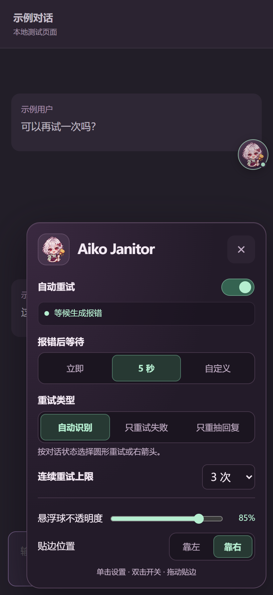

# Aiko Janitor

Janitor AI 网页的自动重试油猴脚本。打开私聊后，小 Aiko 会出现在屏幕边缘。双击开启自动重试，单击打开设置，拖动到另一侧即可贴边。

## 安装

1. 在 Android 上，可用装了 Tampermonkey 的 Edge 或 Firefox。iPhone 可用 Safari 版 Tampermonkey。电脑可用 Chrome、Edge 或 Firefox。 [Tampermonkey 官方安装入口](https://www.tampermonkey.net/faq.php?locale=en&q=Q406)
2. 把 [aiko-janitor.user.js](aiko-janitor.user.js) 下载到要使用的设备，打开 Tampermonkey 的管理面板，在「实用工具」里从文件导入。也可以新建脚本，把文件完整内容粘贴进去并保存。
3. 刷新 Janitor AI 网页并进入一个私聊。第一次安装时自动重试处于关闭状态。双击小 Aiko 开启，或在设置里开启。脚本匹配 [janitorai.com](https://janitorai.com/) 和 [jani.com](https://jani.com/)。

## 重试选项

| 选项 | 行为 |
| --- | --- |
| 自动识别 | 根据聊天状态使用圆形箭头或右箭头。 |
| 只重试失败 | 最后一条自己发出的消息还没收到回复时，点圆形箭头重试。 |
| 只重抽回复 | 已有回复且选中最后一个版本时，点右箭头生成新版本。 |
| 等待时间 | 立即、5 秒或自定义 1–3600 秒。默认 5 秒。 |
| 连续重试上限 | 每轮最多自动点击 1–10 次，默认 3 次。连续自动点击之间至少间隔 2 秒。 |
| 悬浮球 | 不透明度 20%–100%，支持左右贴边和拖动纵向位置。 |

明确的 429、Provider 认证错误和额度错误会暂停本轮。截图中带有 “you may be rate limited” 的网络断连仍可重试。面板会显示倒计时、已点击或暂停原因。倒计时可取消，切换私聊或将页面切到后台也会取消。若网页还没渲染最新消息，脚本会使用站内的跳到底部按钮，等对应操作可用再点。

脚本通过网页上的原生按钮触发生成，设置保存在本地。Janitor AI 的使用条款要求自动化访问获得授权。 [Janitor AI 使用条款](https://jani.com/term)

## 验证

已核对 Janitor AI 当前公开网页代码中的两种生成按钮、回复版本位置和错误提示结构，并用 Chromium 实测相应 DOM 的模拟故障。测试覆盖手机触屏、桌面交互、两种按钮、等待时间、限流、连续失败与对话切换。上图来自本地测试页面。真实账号的 Provider 请求及手机真机仍待验证。
